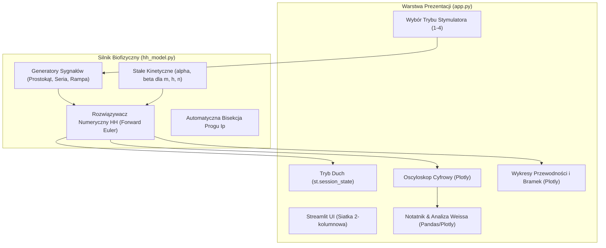

# ⚡ Wirtualna Pracownia Biofizyki Medycznej — Wersja 2.0
## Potencjał Czynnościowy Neuronu i Pobudliwość Błony Komórkowej
### Kompletna Dokumentacja Architektury, Podstaw Biofizycznych oraz Instrukcja Użytkownika

---

## 📌 1. Wstęp i Cel Dydaktyczny

Aplikacja **Wirtualna Pracownia Biofizyki 2.0** jest samodzielnym, zaawansowanym symulatorem właściwości elektrycznych błony komórkowej komórki nerwowej. Aplikacja została w całości dedykowana badaniu **potencjału czynnościowego**, zgodnie z programem ćwiczeń laboratoryjnych opisanym w podręczniku akademickim (*Rozdział 21: Potencjał Czynnościowy Komórki Nerwowej*).

### Główne cele dydaktyczne:
1. Zrozumienie mechanizmu powstawania i przebiegu potencjału czynnościowego w oparciu o nieliniowy model biofizyczny Alana L. Hodgkina i Andrew F. Huxleya (Nagroda Nobla 1963).
2. Poznanie elektrycznego modelu zastępczego błony (Ryc. 7 z podręcznika): rola pojemności błony $C$, sił elektromotorycznych ogniw stężeniowych Nernsta ($E_{Na}, E_K, E_{Cl}$) oraz zmiennych oporów/przewodności ($R_{Na}, R_K, R_{Cl}$).
3. Badanie pobudliwości neuronu i wyznaczanie parametrów krzywej Weissa-Lapicque'a: natężenia progowego $I_p$, reobazy $R$ i chronaksji $CH$.
4. Weryfikacja prawa stałości ładunku progowego $\Delta Q/S = J \cdot \Delta t$ dla krótkich czasów stymulacji oraz zrozumienie przyczyn odchyleń dla długich bodźców (akomodacja, pompy jonowe).
5. Doświadczalne zbadanie zjawisk nieliniowych:
   - **Sumowania bodźców podprogowych w czasie** (bezwładność pojemnościowa błony wg Ryc. 6 z podręcznika),
   - **Reakcji na hiperpolaryzację** ($J < 0$, Pkt 6 ze str. 181),
   - **Refrakcji bezwzględnej i względnej** w układzie dwóch impulsów (Pkt 7 ze str. 181),
   - **Akomodacji neuronu** przy powolnym narastaniu bodźca (rampa prądowa vs bodziec skokowy).

---

## 🏛️ 2. Architektura i Struktura Projektu

Projekt zorganizowano w sposób w pełni modułowy, oddzielając warstwę obliczeń numerycznych od warstwy prezentacji i interfejsu użytkownika.

### Struktura drzewa katalogów:

```text
biofizyka/
├── app.py                         # Główny interfejs aplikacji (Streamlit + Plotly)
├── hh_model.py                    # Dedykowany silnik biofizyczny Hodgkina-Huxleya
├── requirements.txt               # Zależności biblioteczne Pythona (w tym plotly)
├── app_docelowa.py                # Archiwalna wersja demonstracyjna 3-modułowa (backup)
├── ac.py                          # Pierwotny skrypt laboratoryjny z algorytmem Eulera
├── potencjal.md                   # Pełna treść rozdziału podręcznika akademickiego
├── potencjal.pdf                  # Oryginalny skan podręcznika z rycinami
├── audyt_potencjału.md            # Audyt merytoryczny i wytyczne UX
├── technologia.md                 # Analiza architektoniczna i technologiczna
└── INSTRUKCJA_I_DOKUMENTACJA_V2.md # Niniejsza kompletna dokumentacja
```

### Podział odpowiedzialności modułów:



1. **`hh_model.py` (Silnik obliczeniowy):**
   - Implementuje funkcje kinetyczne $\alpha(V)$ i $\beta(V)$ bramek $m, h, n$ zabezpieczone regułą de l'Hôpitala w punktach osobliwych ($0/0$).
   - Zawiera czyste generatory przebiegów prądowych: `generate_single_pulse`, `generate_dual_pulses`, `generate_pulse_train`, `generate_ramp_stimulus`.
   - Implementuje numeryczną metodę Eulera z krokiem $\Delta t = 0.01\text{ ms}$, zapewniającą stabilność rozwiązania nieliniowego układu 4 równań różniczkowych zwyczajnych.
   - Zwraca ustrukturyzowany obiekt `SimulationResult` ze wszystkimi wektorami czasowymi ($t, V, I_{stim}, g_{Na}, g_K, m, h, n, I_{Na}, I_K, I_L$) oraz metrykami kluczowymi ($V_{max}, V_{min}, h_{min}, h_{end}$, flaga potencjału czynnościowego).

2. **`app.py` (Interfejs Streamlit + Plotly):**
   - Obsługuje ergonomiczny układ dwukolumnowy: lewy panel sterowania stymulatorem oraz prawy panel oscyloskopu i kart analitycznych.
   - Zarządza stanem aplikacji w `st.session_state`: zamrażaniem przebiegu referencyjnego (**Tryb Duch**) oraz tabelą pomiarową studenta.
   - Generuje interaktywne wykresy wektorowe Plotly z synchronizacją osi czasu i kursorem pomiarowym crosshair.

---

## 🧬 3. Podstawy Biofizyczne i Model Matematyczny

### 3.1. Elektryczny model zastępczy błony (Hodgkin-Huxley 1952, Ryc. 7)
Błona komórkowa neuronu jest modelowana jako obwód elektryczny zawierający:
- **Kondensator o pojemności $C_m = 1.0\ \mu\text{F/cm}^2$**, reprezentujący dwuwarstwę lipidową będącą dielektrykiem rozdzielającym przewodzące roztwory elektrolitów.
- **Trzy równoległe gałęzie jonowe**, każda złożona z ogniwa stężeniowego Nernsta połączonego szeregowo z oporem kanałowym:
  - Gałąź sodowa: $E_{Na} = +45.0\text{ mV}$, przewodność $g_{Na} = 1/R_{Na}$ (zmienna, zależna od napięcia i czasu).
  - Gałąź potasowa: $E_K = -82.0\text{ mV}$, przewodność $g_K = 1/R_K$ (zmienna, zależna od napięcia i czasu).
  - Gałąź przecieku (głównie Cl⁻ i spoczynkowy K⁺): $E_L = -59.4\text{ mV}$, przewodność stała $g_L = 0.3\text{ mS/cm}^2$.

Równanie bilansu prądów Kirchhoffa dla błony:
$$C_m \frac{dV_m}{dt} = -(I_{Na} + I_K + I_L) + I_{stim}(t)$$

Gdzie prądy jonowe dane są prawem Ohma:
$$I_{Na} = g_{Na}(t, V_m) \cdot (V_m - E_{Na})$$
$$I_K = g_K(t, V_m) \cdot (V_m - E_K)$$
$$I_L = g_L \cdot (V_m - E_L)$$

### 3.2. Kinetyka bramek jonowych $m, h, n$
Przewodności jonowe zależą od prawdopodobieństwa otwarcia bramek białkowych w porach kanałów:
$$g_{Na}(t) = \bar{g}_{Na} \cdot m(t)^3 \cdot h(t) \quad (\bar{g}_{Na} = 120\text{ mS/cm}^2)$$
$$g_K(t) = \bar{g}_K \cdot n(t)^4 \quad (\bar{g}_K = 36\text{ mS/cm}^2)$$

Każda zmienna bramkowania $x \in \{m, h, n\}$ spełnia równanie kinetyczne pierwszego rzędu:
$$\frac{dx}{dt} = \alpha_x(V_m)(1 - x) - \beta_x(V_m)x = \frac{x_\infty(V_m) - x}{\tau_x(V_m)}$$

Współczynniki szybkości przejść:
- **Aktywacja sodu ($m$):**
  $$\alpha_m(V) = \frac{0.1(-V - 45)}{\exp\left(\frac{-V - 45}{10}\right) - 1}, \quad \beta_m(V) = 4.0 \exp\left(\frac{-V - 70}{18}\right)$$
- **Inaktywacja / Dostępność sodu ($h$):**
  $$\alpha_h(V) = 0.07 \exp\left(\frac{-V - 70}{20}\right), \quad \beta_h(V) = \frac{1}{\exp\left(\frac{-V - 40}{10}\right) + 1}$$
- **Aktywacja potasu ($n$):**
  $$\alpha_n(V) = \frac{0.01(-V - 60)}{\exp\left(\frac{-V - 60}{10}\right) - 1}, \quad \beta_n(V) = 0.125 \exp\left(\frac{-V - 70}{80}\right)$$

### 3.3. Zabezpieczenie numeryczne przed osobliwościami
W punktach $V = -45\text{ mV}$ (dla $\alpha_m$) oraz $V = -60\text{ mV}$ (dla $\alpha_n$) mianowniki przyjmują wartość zero ($0/0$). Zastosowano ścisłe granice analityczne de l’Hôpitala:
$$\lim_{V \to -45} \alpha_m(V) = 1.0, \qquad \lim_{V \to -60} \alpha_n(V) = 0.1$$

---

## 🎛️ 4. Opis Interfejsu i Funkcji Stanowiska

Stanowisko podzielone jest na dwa główne bloki:

### 4.1. Lewy Panel — Wirtualny Stymulator
1. **Wybór trybu pracy stymulatora:**
   - `1️⃣ Pojedynczy impuls`: do wyznaczania progów pobudliwości $I_p$, badania krzywej Weissa oraz hiperpolaryzacji.
   - `2️⃣ Dwa impulsy`: do badania refrakcji bezwzględnej i względnej oraz akomodacji wg Pkt 5 i 7 z podręcznika.
   - `3️⃣ Seria impulsów`: do badania sumowania bodźców podprogowych w czasie wg Ryc. 6 z podręcznika.
   - `4️⃣ Rampa narastająca`: do badania akomodacji przy powolnym narastaniu bodźca.
2. **Biblioteka nastaw (Presety dydaktyczne):**
   Każdy tryb zawiera rozwijaną listę wzorcowych nastaw laboratoryjnych (np. *„Bodziec podprogowy”*, *„Refrakcja bezwzględna”*, *„Krótki odstęp -> sumowanie”*), pozwalających natychmiast zaprezentować kluczowe zjawiska.
3. **Pola wprowadzania parametrów:**
   - Czas trwania bodźca $\Delta t$ [ms],
   - Gęstość prądu bodźca $J$ (lub $I$) [$\mu\text{A/cm}^2$] (z obsługą wartości ujemnych dla hiperpolaryzacji),
   - Odstęp $\Delta \tau$ między impulsami [ms],
   - Podstawa czasu oscyloskopu $t_{max}$ [ms].
4. **Tryb Duch (Ghost Trace):**
   - Przycisk **„📌 Zamroź ślad”**: zapisuje bieżący stan przebiegu do pamięci podręcznej.
   - Przycisk **„❌ Usuń ślad”**: czyści zapamiętany przebieg.
   - Po zamrożeniu, poprzednia krzywa rysuje się na oscyloskopie jako szara, przerywana linia referencyjna.
5. **Wskaźniki stanu chwilowego komórki:**
   - Odznaka statusu: `⚡ Potencjał czynnościowy wygenerowany` vs `💤 Stan podprogowy (brak potencjału czynnościowego)`.
   - Kafelki KPI: napięcie maksymalne $V_{max}$ [mV] oraz minimalne $V_{min}$ [mV].
   - **Wskaźnik dostępności kanałów $\text{Na}^+$ ($h$):** pasek postępu pokazujący bieżący odsetek kanałów sodowych gotowych do aktywacji.

---

### 4.2. Prawy Panel — Zakładki Laboratoryjne

#### 📺 Zakładka 1: Dwukanałowy Oscyloskop Laboratoryjny
- **Kanał 1 (Góra):** Potencjał błonowy $V_m(t)$ [mV]. Wyświetla linię zerową ($0\text{ mV}$), poziom progu pobudliwości ($\sim -55\text{ mV}$) oraz poziom spoczynkowy ($-70\text{ mV}$).
- **Kanał 2 (Dół):** Prąd stymulujący $I_{stim}(t)$ [$\mu\text{A/cm}^2$].
- **Cechy oscyloskopu:**
  - W pełni zsynchronizowana podstawa czasu $t$,
  - Zintegrowany kursor pomiarowy (crosshair hover): najechanie myszą wyświetla dokładne wartości liczbowe dla danego punktu czasowego,
  - Możliwość powiększania (zoom) i przesuwania (pan),
  - Automatyczny odczyt pod ekranem: czas szczytu potencjału czynnościowego, hiperpolaryzacja następcza.

#### 🧬 Zakładka 2: Przewodności & Bramki Jonowe
- **Wykres 1:** Przewodności elektryczne błony dla jonów sodowych $g_{Na} = 1/R_{Na}$ oraz potasowych $g_K = 1/R_K$ (dokładne nawiązanie do oporów z Ryc. 7).
- **Wykres 2:** Dynamiczny stan trzech bramek kinetycznych:
  - $m$ (błękitna): aktywacja sodu,
  - $h$ (pomarańczowa): dostępność / inaktywacja sodu,
  - $n$ (fioletowa): aktywacja potasu.
- Karta wyjaśniająca mechanizm molekularny refrakcji i akomodacji.

#### 📊 Zakładka 3: Notatnik & Krzywa Pobudliwości (Zadanie 2)
- Narzędzie do zbierania danych pomiarowych:
  - Zapisywanie bieżących nastaw oscyloskopu jednym kliknięciem (*„➕ Zapisz punkt”*),
  - Możliwość manualnego wprowadzania punktów pomiarowych,
  - Tabela z automatycznym wyliczaniem $1/\Delta t$ oraz ładunku progowego $\Delta Q/S = I_p \cdot \Delta t$,
  - Pobieranie danych do formatu CSV (`pomiary_pobudliwosci_potencjal.csv`).
- **Automatyczna analiza danych (po dodaniu $\ge 2$ punktów):**
  1. *Wykres 1:* Krzywa pobudliwości $I_p = f(\Delta t)$ (Krzywa Weissa-Lapicque'a),
  2. *Wykres 2:* Linearyzacja $I_p = f(1/\Delta t)$ z dopasowaną prostą regresji, odczytem reobazy $R$ (przecięcie z osią $Y$) oraz chronaksji $CH = u / R$,
  3. *Wykres 3:* Zależność ładunku progowego $\Delta Q/S = f(\Delta t)$ ilustrująca stałość ładunku dla małych $\Delta t$ i jego ucieczkę przy długich bodźcach.

#### 📖 Zakładka 4: Przewodnik Laboratoryjny
- Wbudowany podręczny opis realizacji każdego z 4 zadań badawczych.

---

## 📋 5. Instrukcja Wykonania Zadań Laboratoryjnych

### Zadanie 1: Anatomia potencjału i model Hodgkina-Huxleya
1. W lewym panelu wybierz `1️⃣ Pojedynczy impuls`.
2. Ustaw czas trwania bodźca $\Delta t = 1.0\text{ ms}$.
3. Wczytaj preset *„Bodziec podprogowy”* ($J = 5.0\ \mu\text{A/cm}^2$). Kliknij *„📌 Zamroź ślad”* (włączenie Trybu Ducha).
4. Zwiększ natężenie do wartości ponadprogowej ($J = 15.0\ \mu\text{A/cm}^2$).
5. **Obserwacja na zintegrowanym oscyloskopie:**
   - **Wykładnicze narastanie i opadanie potencjału podprogowego** (wynikające z ładowania i rozładowania pojemności elektrycznej błony $C$ – porównaj z Ryc. 3b i Ryc. 7 w podręczniku).
   - **Gwałtowny wzrost przewodności sodowej $1/R_{Na}$** odpowiadający za fazę depolaryzacji i szczyt przepolaryzowania ($U_{max} \approx +30\text{ mV}$ do $+35\text{ mV}$) po przekroczeniu progu $-60\text{ mV}$.
   - **Opóźniony wzrost przewodności potasowej $1/R_K$** odpowiadający za repolaryzację oraz następczy potencjał hiperpolaryzacyjny ($U_{min} \approx -96\text{ mV}$ do $-97\text{ mV}$).

---

### Zadanie 2: Krzywa pobudliwości, reobaza, chronaksja i bilans ładunku
*(Zgodnie z Pkt 1–4 ze str. 180–181 podręcznika)*

1. W trybie pojedynczego impulsu dobierz metodą kolejnych przybliżeń (bisekcji) minimalne natężenie progowe $I_p$, które wyzwala potencjał czynnościowy ($V_{max} > 0\text{ mV}$), dla następujących czasów trwania bodźca $\Delta t$:
   - $\Delta t = 0.3\text{ ms}$ (oczekiwane $I_p \approx 21.7\ \mu\text{A/cm}^2$),
   - $\Delta t = 0.5\text{ ms}$ (oczekiwane $I_p \approx 13.2\ \mu\text{A/cm}^2$),
   - $\Delta t = 1.0\text{ ms}$ (oczekiwane $I_p \approx 6.9\ \mu\text{A/cm}^2$),
   - $\Delta t = 2.0\text{ ms}$ (oczekiwane $I_p \approx 3.8\ \mu\text{A/cm}^2$),
   - $\Delta t = 4.0\text{ ms}$ (oczekiwane $I_p \approx 2.5\ \mu\text{A/cm}^2$),
   - $\Delta t = 10.0\text{ ms}$ (oczekiwane $I_p \approx 2.2\ \mu\text{A/cm}^2$).
2. Po znalezieniu każdego progu kliknij **„➕ Zapisz punkt (Δt, I)”** w zakładce *Notatnik & Krzywa Pobudliwości*.
3. **Analiza wyników w Notatniku:**
   - Sprawdź wyznaczoną prostą $I_p = f(1/\Delta t)$. Odczytaj współczynnik $u$, reobazę $R$ oraz chronaksję $CH$:
     $$I_p = (CH \cdot R) \cdot \frac{1}{\Delta t} + R \implies CH = \frac{u}{R}$$
   - Przeanalizuj wykres ładunku progowego $\Delta Q/S = I_p \cdot \Delta t$: zauważ, że w zakresie $0.3 - 1.0\text{ ms}$ ładunek jest niemal idealnie stały ($\approx 6.5\ \mu\text{C/cm}^2$), natomiast przy $10.0\text{ ms}$ wzrasta ponad trzykrotnie. Wyjaśnij to działaniem pomp jonowych oraz rozwijającą się akomodacją.
4. Pobierz plik CSV do dołączenia do protokołu.

---

### Zadanie 3: Sumowanie bodźców w czasie (Ryc. 6) vs Hiperpolaryzacja (Pkt 6)

#### Część A: Sumowanie czasowe (Ryc. 6 ze str. 179)
1. Wybierz tryb `3️⃣ Seria impulsów: Sumowanie czasowe`.
2. Ustaw liczbę impulsów $N = 3$, prąd $I = 6.5\ \mu\text{A/cm}^2$ oraz czas trwania $\Delta t = 0.8\text{ ms}$ (pojedynczy impuls o takich parametrach jest podprogowy!).
3. Ustaw krótki odstęp między impulsami $\Delta \tau = 1.0\text{ ms}$.
   - **Wynik:** Błona nie zdąży się rozładować pomiędzy impulsami — potencjał schodkowo narasta i trzeci impuls przekracza próg, wyzwalając pełny potencjał czynnościowy!
4. Zamroź ślad przyciskiem *„📌 Zamroź ślad”*.
5. Zwiększ przerwę do $\Delta \tau = 4.0\text{ ms}$.
   - **Wynik:** Przy większym odstępie potencjał po każdym impulsie zdąży powrócić do stanu spoczynkowego. Potencjał czynnościowy nie zostaje wygenerowany. Na ekranie oscyloskopu widać wyraźne porównanie obu sytuacji.

#### Część B: Badanie hiperpolaryzacji (Pkt 6 ze str. 181)
1. Przełącz na tryb `1️⃣ Pojedynczy impuls`.
2. Ustaw czas $\Delta t = 5.0\text{ ms}$ i podawaj ujemne gęstości prądu: $J = -5.0$, $J = -10.0$, $J = -20.0\ \mu\text{A/cm}^2$.
3. Obserwuj zachowanie błony:
   - Potwierdza to regułę ze str. 178 podręcznika: *„Długotrwała depolaryzacja inaktywuje układ Na, a hiperpolaryzacja ułatwia jego aktywację”*.

---

### Zadanie 4: Dwa mechanizmy wzrostu progu — Akomodacja vs Refrakcja

#### Część A: Badanie refrakcji (Pkt 7 ze str. 181)
1. Wybierz tryb `2️⃣ Dwa impulsy: Refrakcja / Akomodacja`.
2. Ustaw impuls 1 ponadprogowy: $I_1 = 30.0\ \mu\text{A/cm}^2$, $\Delta t_1 = 1.0\text{ ms}$.
3. Ustaw impuls 2 silny: $I_2 = 40.0\ \mu\text{A/cm}^2$, $\Delta t_2 = 1.0\text{ ms}$.
4. Zbadaj reakcję dla różnych odstępów $\Delta \tau$:
   - $\Delta \tau = 1.5\text{ ms}$ (**Refrakcja bezwzględna**): drugi impuls w ogóle nie wyzwala potencjału czynnościowego.
   - $\Delta \tau = 5.0\text{ ms}$ (**Refrakcja względna**): drugi impuls wyzwala potencjał czynnościowy, ale ma on wyraźnie mniejszą amplitudę, a próg jego wyzwolenia jest wyższy (wciąż wysoka przewodność $g_K$ tłumi depolaryzację).
   - $\Delta \tau = 15.0\text{ ms}$ (**Powrót do normy**): pełna amplituda kolejnego potencjału czynnościowego.

#### Część B: Badanie akomodacji (Rampa liniowo narastająca)
1. Wybierz tryb `4️⃣ Rampa liniowo narastająca: Akomodacja`.
2. Ustaw docelowe natężenie $I_{max} = 3.5\ \mu\text{A/cm}^2$ (wartość ponadprogowa dla bodźca prostokątnego).
3. Ustaw krótki czas narastania rampy $\Delta t_{rampy} = 1.0\text{ ms}$ (szybki skok).
   - **Wynik:** Błona generuje potencjał czynnościowy ($V_{max} \approx +33.6\text{ mV}$).
4. Zamroź ślad przyciskiem *„📌 Zamroź ślad”*.
5. Zmień czas narastania rampy na powolny: $\Delta t_{rampy} = 18.0\text{ ms}$.
   - **Wynik:** Pomimo osiągnięcia identycznego prądu $3.5\ \mu\text{A/cm}^2$, potencjał czynnościowy w ogóle nie powstaje ($V_{max} \approx -66.9\text{ mV}$)!
   - **Wyjaśnienie:** W zakładce *Przewodności & Bramki* widać, że w trakcie powolnego wzrostu prądu bramki $h$ uległy stopniowej inaktywacji, zanim depolaryzacja osiągnęła próg.

---

## 💻 6. Wymagania Techniczne i Uruchomienie

### Wymagania systemowe:
- System operacyjny: Linux, macOS lub Windows
- Python w wersji: $\ge 3.10$ (zalecany Python 3.11 lub 3.12)
- Pakiety: `streamlit`, `plotly`, `numpy`, `scipy`, `pandas`

### Instalacja i uruchomienie krok po kroku:

1. **Przejdź do katalogu projektu:**
   ```bash
   cd /home/wawrzyniec/Dokumenty/biofizyka
   ```

2. **Aktywuj środowisko wirtualne:**
   ```bash
   source .venv/bin/activate
   ```

3. **Zainstaluj/zaktualizuj wymagane pakiety:**
   ```bash
   pip install -r requirements.txt
   ```

4. **Uruchom aplikację:**
   ```bash
   streamlit run app.py
   ```

5. **Dostęp do aplikacji:**
   Po uruchomieniu aplikacja otwiera się w przeglądarce internetowej pod adresem:
   ```text
   http://localhost:8501
   ```
